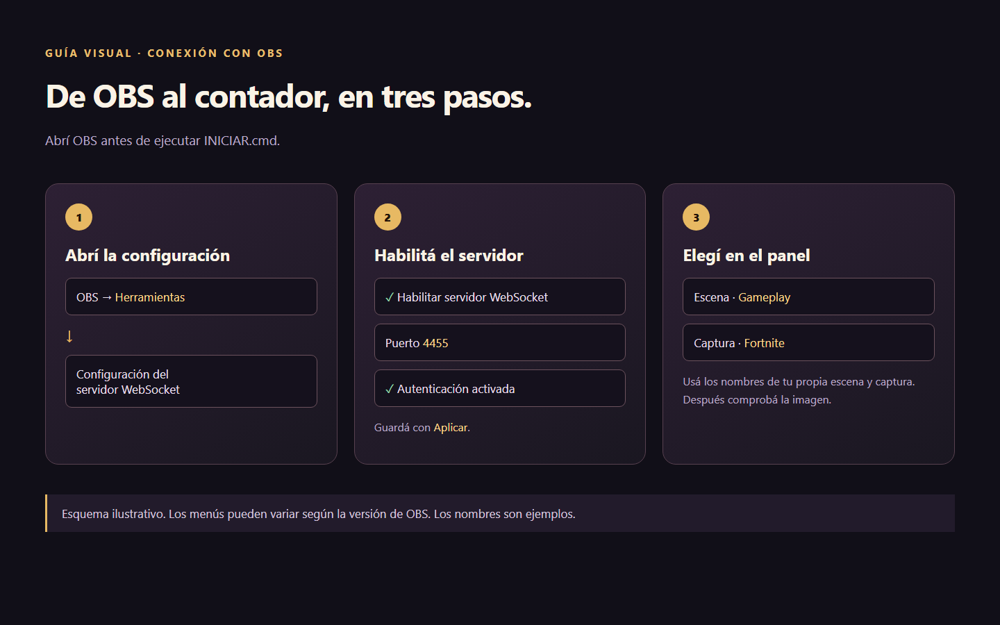
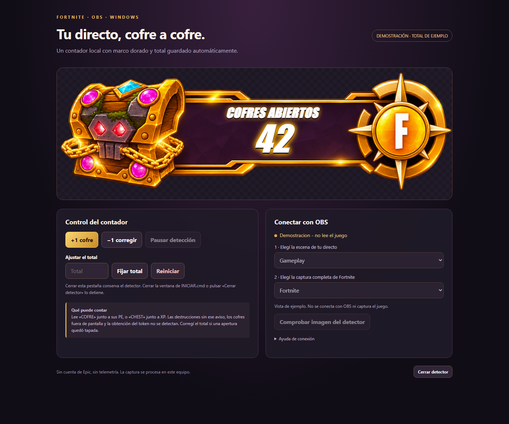

# Contador de cofres para OBS

Contador visual para **Fortnite en Windows**, con marco dorado, panel local y fuentes nativas de imagen y texto en OBS Studio. El total se guarda entre sesiones. No requiere una cuenta de Epic ni una clave de API.


> **Alcance real:** cuenta los avisos visibles «COFRE + PE» y «CHEST + XP». No cuenta de forma fiable los cofres destruidos sin ese aviso, los cofres ocultos, ni confirma que haya salido el token. Puede perder aperturas muy seguidas. Es una herramienta visual con corrección manual, no un contador oficial de eventos de Fortnite.

## Empezar

1. Instalá **[OBS Studio](https://obsproject.com/download)** y **[Python 3.12](https://www.python.org/downloads/)** en Windows 10 u 11. Si usás el instalador de Python, activá la opción de añadir Python al PATH. También podés usar una instalación existente de [uv](https://docs.astral.sh/uv/getting-started/installation/).
2. En GitHub, pulsá **Code → Download ZIP** y **extraé toda la carpeta** en una ubicación donde puedas escribir. No ejecutes los archivos desde dentro del ZIP.
3. Abrí **`INSTALAR.cmd`**. La primera instalación necesita internet para descargar las dependencias. Cuando termine, indicará que podés ejecutar `INICIAR.cmd`.
4. En OBS, abrí **Herramientas → Configuración del servidor WebSocket**, activá **Habilitar servidor WebSocket** y pulsá **Aplicar**. Podés conservar la autenticación activada.
5. Abrí **`INICIAR.cmd`**. En el panel, elegí **la escena de tu directo** y **la captura completa de Fortnite**. El programa añadirá `Contador de cofres - Overlay` a esa escena.
6. Pulsá **Comprobar imagen del detector**. Debe verse el juego completo. Después, abrí un cofre y comprobá que su aviso de recompensa suma una unidad.



**[Manual ilustrado completo →](docs/MANUAL.md)** · **[Solución de problemas →](docs/MANUAL.md#solución-de-problemas)**

## Panel y directo



- **+1 / −1 / Fijar total:** permiten corregir el contador.
- **Pausar:** conserva el total y detiene temporalmente la detección.
- **Reiniciar:** vuelve a cero después de pedir confirmación.
- **Cerrar detector:** detiene el programa. Cerrar únicamente la pestaña del panel no lo detiene.
- En OBS, desbloqueá `Contador de cofres - Overlay` para moverlo o cambiar su tamaño. Al cerrar el detector, la imagen y el último número permanecen visibles, pero dejan de actualizarse.

El panel está en `http://127.0.0.1:18746/`. El programa debe seguir ejecutándose durante el directo. No arranca automáticamente con Windows.

## Qué necesita y qué limita la detección

- OBS con WebSocket 5, incluido en OBS Studio 28 y posteriores. La integración nativa de texto es para Windows.
- Una captura visible y activa del juego, con el aviso de recompensa dentro de la imagen. El recorte predeterminado se preparó para un HUD de relación 16:9.
- Los rótulos en español o inglés indicados arriba. Otros idiomas o cambios del HUD pueden requerir ajustes.
- Detección por OCR en CPU. Su velocidad depende del equipo y de la carga del juego; no se garantiza un tiempo exacto ni un conteo perfecto.
- El aspecto del cofre no es lo que decide el conteo: cualquier tipo necesita producir un aviso compatible. Las destrucciones por pico, disparos, vehículos o explosiones que no lo muestran quedan fuera del método actual.

## Privacidad

La aplicación lee capturas de una fuente de OBS y las procesa localmente. No envía imágenes, nombres, cuentas ni conteos a un servidor externo. No modifica archivos de Fortnite ni lee su memoria. Las dependencias se descargan de internet durante la instalación.

Las escenas elegidas, el total y los registros quedan en `datos/`, excluido por `.gitignore`. La contraseña de WebSocket se lee de la configuración local de OBS o de una variable de entorno; no se guarda en el proyecto ni se muestra en el panel. **No compartas tu carpeta `datos/`, la configuración privada de OBS ni archivos `.env`.**

Las imágenes de este repositorio usan datos de demostración; no incluyen grabaciones ni capturas personales de una partida.

## Desarrollo

```powershell
.venv\Scripts\python.exe -m pip install -r requirements-dev.txt
.venv\Scripts\python.exe -m pytest
```

Demo sin acceder a OBS ni capturar el juego:

```powershell
.venv\Scripts\python.exe contador.py --demo --port 18747
```

El [manual](docs/MANUAL.md) explica la configuración portable, puertos, región OCR y la revisión de vídeos locales. Los cambios de configuración son locales; `config.example.json` es solamente una plantilla.

## Licencia y créditos

El código se publica bajo [MIT](LICENSE). El marco es una ilustración generada con IA para este proyecto; ver [NOTICE](NOTICE.md). Las dependencias conservan sus propias licencias. Proyecto de fans no oficial, sin afiliación ni respaldo de Epic Games, Fortnite u OBS.
