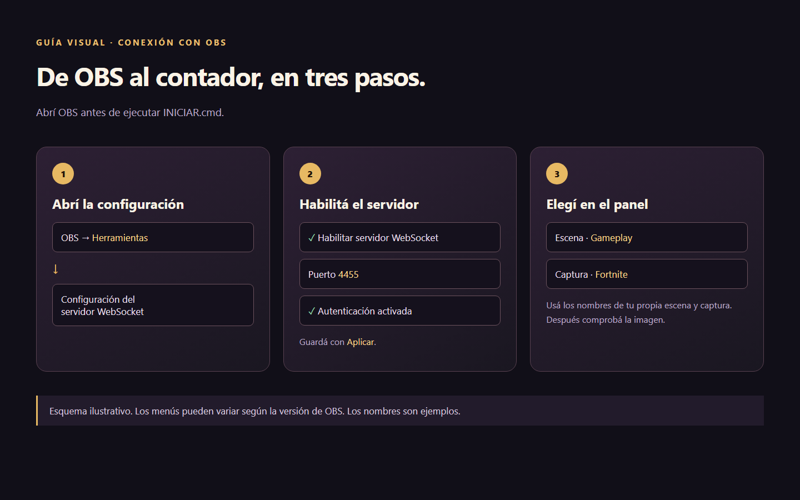
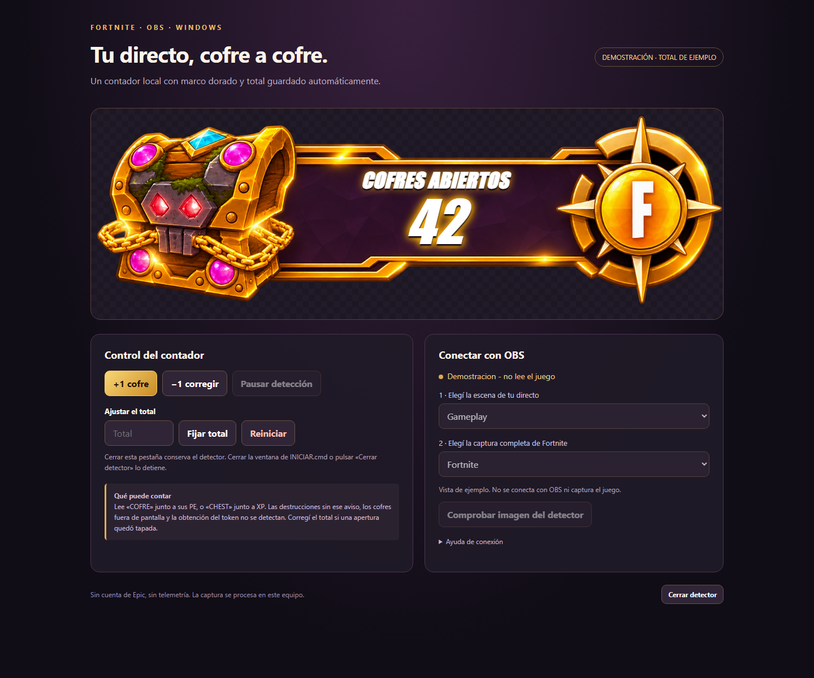

# Manual ilustrado

Este manual explica cómo instalar el contador, conectarlo a tu propia escena de OBS y mantenerlo en funcionamiento. Los nombres `Gameplay`, `Fortnite` y el número `42` de las imágenes son ejemplos del modo demostración.

## 1. Preparar el equipo

Necesitás Windows 10 u 11 de 64 bits, OBS Studio con WebSocket 5 y Python 3.12. Python 3.13 también se admite en la ruta de instalación manual. Si ya tenés uv, el instalador lo usa para preparar Python 3.12 automáticamente.

Descargá el proyecto desde **Code → Download ZIP** en GitHub. Hacé clic derecho en el ZIP → **Extraer todo**. Conservá las subcarpetas `assets`, `scripts` y `docs`.

Podés usar, por ejemplo, una carpeta llamada `ContadorCofres` dentro de Documentos. Evitá carpetas donde tu usuario no tenga permiso de escritura. La carpeta `.venv` depende de su ubicación: si movés el proyecto, volvé a ejecutar `INSTALAR.cmd` para regenerarla.

## 2. Instalar

1. Abrí `INSTALAR.cmd` con doble clic.
2. Esperá a que se cree `.venv` y se descarguen las dependencias. La ventana debe terminar con **Listo. Abre OBS y despues INICIAR.cmd.**
3. Si no encuentra Python, instalá Python 3.12 desde [python.org](https://www.python.org/downloads/), activá su opción de añadirlo al PATH y repetí el paso anterior. El instalador busca primero uv, después el lanzador `py -3.12` y por último `python`.

No necesitás instalar paquetes globalmente ni ejecutar el proyecto como administrador por defecto.

## 3. Habilitar WebSocket en OBS

Abrí OBS y seguí **Herramientas → Configuración del servidor WebSocket**. Marcá **Habilitar servidor WebSocket**, conservá el puerto `4455` si no necesitás otro y pulsá **Aplicar**.

La siguiente imagen es un esquema explicativo, no una captura de una cuenta o una instalación personal. Los menús pueden variar ligeramente según la versión de OBS.



**Autenticación:** podés mantenerla habilitada. En una instalación normal de OBS, el contador lee la contraseña desde `%APPDATA%\obs-studio\plugin_config\obs-websocket\config.json` y la usa solamente en memoria. No la copies en un issue de GitHub, un vídeo ni una captura.

### OBS portable o configuración personalizada

Cerrá el detector antes de cambiar estas opciones. Elegí una de estas dos formas:

- Indicá la ruta de la configuración portable con `COFRES_OBS_CONFIG`, o con `obs_config_path` dentro de tu `datos/config.local.json`.
- Definí `COFRES_OBS_PORT` y `COFRES_OBS_PASSWORD` en la terminal desde la que vayas a iniciar el programa. Son variables locales de esa sesión.

Ejemplo para una instalación portable, usando una ruta de ejemplo:

```powershell
$env:COFRES_OBS_CONFIG = 'E:\OBS-Portable\config\obs-studio\plugin_config\obs-websocket\config.json'
.venv\Scripts\python.exe contador.py
```

No desactives la autenticación para resolver un problema de contraseña. Revisá que estés señalando la configuración de la instancia de OBS que realmente está abierta.

## 4. Elegir tu escena y tu captura

1. Abrí `INICIAR.cmd`. Se abre el panel en `http://127.0.0.1:18746/`.
2. En **1 · Elegí la escena de tu directo**, seleccioná la escena que vas a emitir. No elijas una escena de ejemplo por su nombre: tiene que ser la tuya.
3. En **2 · Elegí la captura completa de Fortnite**, elegí preferentemente una fuente **Captura de juego** que apunte a Fortnite. También se admiten capturas de pantalla o ventana visibles en esa escena.
4. Pulsá **Comprobar imagen del detector**. Confirmá que aparece el juego completo, con el aviso de recompensa sin recortar.

El programa no crea el overlay hasta que elegís una escena válida. La primera vez añade `Contador de cofres - Overlay`, una escena anidada con el marco y dos fuentes de texto nativo. Las fuentes existentes del juego y del audio conservan su configuración.



Si no aparecen escenas, revisá la conexión WebSocket. Si la imagen está negra, abrí el juego y revisá las propiedades y el ojo de la fuente de captura en OBS. Los nombres de escena y fuente se guardan únicamente en `datos/config.local.json`.

## 5. Colocar el contador

En **Fuentes**, seleccioná `Contador de cofres - Overlay`. Desbloquealo con el candado y arrastrá sus esquinas para cambiar el tamaño. Arrastralo para colocarlo donde prefieras. Volvé a bloquearlo para evitar movimientos accidentales.

El marco tiene transparencia real. No necesitás filtros de clave de color ni eliminar un fondo negro. La integración principal usa imagen y texto nativos de OBS y conserva el último total aunque el navegador de OBS o el servidor del panel deje de funcionar.


La página `http://127.0.0.1:18746/overlay` sigue disponible como alternativa para una fuente Navegador de `1000 × 334`. Necesita que el servidor esté abierto; para uso normal se recomienda la integración nativa creada automáticamente.

## 6. Comprobar una apertura

Abrí un cofre de forma normal y observá el aviso «COFRE» con sus PE. El contador debería sumar una unidad al reconocerlo. El mismo aviso visible se bloquea temporalmente para evitar que cada fotograma lo sume de nuevo.

La herramienta reconoce texto del HUD, no el estado interno del cofre. Por eso:

- No cuenta de forma fiable los cofres destruidos sin aviso de recompensa, aunque caiga botín.
- No sabe cuántos cofres ocultos rompió una explosión.
- Puede perder aperturas muy seguidas por el bloqueo contra duplicados, una lectura lenta o un aviso tapado.
- No confirma la obtención del token, las recompensas ni probabilidades oficiales.
- No se garantiza la detección de todos los tipos de cofre; necesitan mostrar un rótulo compatible.

Si falta uno, usá **+1 cofre**. Si sobra uno, **−1 corregir**. Esas correcciones también quedan guardadas.

## 7. Uso diario y cierre

- **Fijar total:** escribí un entero entre 0 y 9 999 999 y pulsá el botón.
- **Pausar detección:** conserva el total; **Reanudar** vuelve a leer la captura.
- **Reiniciar:** pide confirmación y vuelve a cero.
- **Cerrar la pestaña:** el programa continúa si su ventana de ejecución sigue abierta.
- **Cerrar detector** o cerrar la ventana de `INICIAR.cmd`: detiene el conteo. El overlay nativo conserva el último número; que siga visible no significa que el detector esté activo.
- **Apagar o reiniciar el PC:** para volver a contar, abrí OBS y ejecutá otra vez `INICIAR.cmd`. El proyecto no configura inicio automático.

Los datos se guardan en `datos/cuenta.json`, `datos/config.local.json`, `datos/total-nativo.txt` y `datos/detector.log`. Para respaldar tu total, guardá una copia privada de `datos/`. No la publiques.

## Solución de problemas

| Síntoma | Qué revisar |
|---|---|
| `INSTALAR.cmd` no encuentra Python | Instalá Python 3.12 con PATH y volvé a abrir el instalador. Si usás `py`, verificá `py -3.12 --version`. |
| Error al descargar dependencias | Revisá internet y ejecutá otra vez `INSTALAR.cmd`; el mensaje de la ventana indica qué descarga falló. |
| El panel no abre | Mantené abierta la ventana de `INICIAR.cmd` y visitá `http://127.0.0.1:18746/`. Revisá sus errores. |
| Puerto ocupado | Puede haber otra copia del contador. Cerrala o arrancá con `--port 18747`. |
| No conecta con OBS | OBS debe estar abierto, WebSocket habilitado y el puerto/contraseña deben corresponder a esa instalación. |
| No aparece el overlay | Elegí una escena en el panel y comprobá que esa misma escena está activa en OBS; activá el ojo del overlay. |
| El overlay está quieto | Comprobá que el detector siga abierto, que no esté pausado y que el panel indique lecturas recientes. |
| Captura negra o sin juego | Revisá la fuente elegida y su visibilidad. Volvé al juego y comprobá la imagen desde el panel. |
| Abro un cofre y no suma | Debe verse el aviso compatible. Revisá recorte, idioma, HUD y velocidad de aperturas; corregí con +1 si hace falta. |
| Rompo cofres y no suma | Las destrucciones sin aviso están fuera del método actual. No se arregla cambiando la imagen del marco. |
| Moví la carpeta y dejó de arrancar | Volvé a ejecutar `INSTALAR.cmd` para crear el entorno en su nueva ubicación. |

## Configuración avanzada

`config.example.json` muestra los campos disponibles. La aplicación genera su configuración en `datos/config.local.json`; editá solamente esa copia con el detector cerrado.

| Campo | Uso |
|---|---|
| `scene` | Nombre exacto de la escena elegida. También se cambia desde el panel. |
| `source` | Nombre exacto de la captura elegida. |
| `interval` | Intervalo mínimo entre lecturas, de 0,2 a 2 segundos. El OCR puede tardar más. |
| `crop` | `[x1, y1, x2, y2]` de la región OCR, coordenadas entre 0 y 1 respecto al juego completo. |
| `obs_config_path` | Ruta local opcional para una configuración portable de OBS. |

La región inicial es `[0.48, 0.20, 0.82, 0.64]`. Su punto de origen es la esquina superior izquierda. Un HUD o una relación de aspecto distintos pueden requerir ajustes. Una región mayor puede aumentar el consumo y los errores; conservá una copia de la configuración antes de experimentar.

El servidor escucha solamente en `127.0.0.1`. `--port` cambia el puerto del panel; `COFRES_OBS_PORT` cambia el del servidor WebSocket de OBS. Son conexiones diferentes.

## Desarrollo y validación

Instalá las herramientas de desarrollo y ejecutá las pruebas:

```powershell
.venv\Scripts\python.exe -m pip install -r requirements-dev.txt
.venv\Scripts\python.exe -m pytest
```

Para mostrar la interfaz sin OBS ni acceso al juego:

```powershell
.venv\Scripts\python.exe contador.py --demo --port 18747
```

El modo demo muestra nombres genéricos y un total de ejemplo; sus datos se guardan por separado en `.demo-data/`.

Para analizar un vídeo propio sin modificar tu total:

```powershell
.venv\Scripts\python.exe -m pip install av
.venv\Scripts\python.exe contador.py --test-video 'ejemplo.mp4'
```

El informe se escribe en `datos/validacion-clips.json` y registra el nombre del archivo, no su ruta absoluta. Revisá también ese nombre antes de compartirlo. No subas vídeos personales al repositorio.

## Compartir un problema sin exponer tus datos

Indicá Windows, Python, OBS, el comportamiento esperado y el observado. Podés usar la demo para una captura del panel. No adjuntes `datos/`, contraseñas, archivos `.env`, capturas de cuenta o grabaciones con datos personales sin revisarlos antes. Consultá [PRIVACIDAD.md](../PRIVACIDAD.md).
